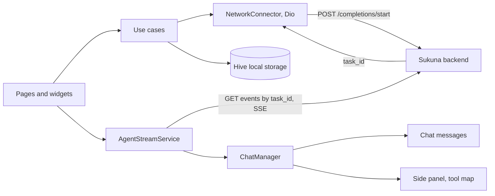

# Midsphere Studio

Midsphere Studio is the Flutter client for Sukuna, Midsphere AI's general agent. One codebase builds for web, Windows, macOS, Linux, Android and iOS.

You type a task, attach files, and watch the agent work. The chat shows the agent's messages as they stream in. A side panel shows what the agent is doing right now: the terminal it is typing in, the file it is editing, the plan it is following, the page it is browsing.

It was built between September 2025 and February 2026. Midsphere AI wound down in 2026. This is published as it was and is not maintained.

## What is in it

- 217 Dart files, about 39,700 lines.
- 75 backend endpoints behind one typed network layer, across 7 domains: agents, memory, billing, spaces, workspace, schedule and CMS.
- Live agent streaming over server-sent events, with reconnection, exponential backoff and `Last-Event-ID` resume.
- A tool map that turns 83 agent tools into 12 kinds of side-panel view: terminal, editor, diff viewer, plan viewer, table, list, map, image preview, video preview, code block, confirmation and error.
- Chat with file uploads, follow-up suggestions, incognito mode and paginated history.
- Pages for add-ons and their connection status, spaces, MCP servers, LLM providers with your own keys, scheduled tasks, search, notifications, onboarding, support tickets, settings and billing.
- Email and Google sign-in.
- 14 colour schemes and 8 accent colours.
- A custom title bar on desktop, and native notifications on Windows, macOS and Linux.

## How it works



Every API call goes through `NetworkConnector` in `lib/logics/domain/usecases/base.dart`. Each domain declares its endpoints as an enum with the path, method, required parameters and return type. Use case classes expose them as static methods, for example `Agent.startExecution()`. The connector validates parameters, adds the bearer token, parses the response into entities and handles pagination.

Sending a message posts to `/completions/start`. The backend prepares the sandbox and returns a `task_id`. The client then opens an SSE stream for that task. `BaseSSEService` keeps the stream alive, reconnects with backoff and resumes from the last event it saw. `ChatManager` turns events into chat messages. The side panel reads each tool call, looks it up in the tool map and picks the matching view.

State is held in a small generic bloc layer (`BaseBloc`, `SimpleBloc`) and in Hive boxes for the session, settings and local storage. Routing uses GoRouter.

More detail is in `docs/`:

- `architecture-usecases.md` describes the network and use case layer.
- `orbiter-migration-guide.md` describes the backend API after Sukuna moved to Orbiter (now [Exo](https://github.com/midsphere-ai/exo)).
- `billing-api.md` describes the billing endpoints.

## Layout

```
lib/
  main.dart            app start, Hive, Sentry, notifications
  logics/
    data/              global config, themes, helpers, auth provider
    domain/
      blocs/           base, simple and login blocs
      entities/        data models
      usecases/        endpoint enums and use cases per domain
    services/          SSE services, Google sign-in
  pages/
    chat/              chat UI, input, messages, side panel, file viewers
    home/              home shell and sidebar
    expanded/          add-ons, spaces, MCP, LLM, schedule, search, onboarding
    settings/          settings and billing
    login/  support/  test/
  widgets/             shared widgets, animations, builders, window chrome
  packages/            markdown rendering
  hive/                Hive adapters
android/ ios/ linux/ macos/ web/ windows/   platform runners
docs/                  architecture and API notes
```

## Setup and run

You need Flutter with Dart 3.8.1 or newer, and a running Sukuna backend.

```bash
flutter pub get
dart run build_runner build
flutter run -d chrome --dart-define=API_URL=http://127.0.0.1:8000/
```

Use `-d macos`, `-d windows` or `-d linux` for desktop. Build a release with `flutter build web`, `flutter build macos` and so on.

## Configuration

Values are passed at build time with `--dart-define`.

| Name | Purpose | Default |
| --- | --- | --- |
| `API_URL` | Base URL of the Sukuna backend | `http://127.0.0.1:8000/` |
| `GOOGLE_CLIENT_ID` | Google sign-in client ID | empty |
| `SENTRY_DSN` | Sentry DSN for error reporting. Sentry is off when empty | empty |

PostHog analytics is configured per platform. Put your own key and host in `web/index.html`, `android/app/src/main/AndroidManifest.xml` and `ios/Runner/Info.plist`, where the placeholders `YOUR_POSTHOG_API_KEY` and `https://posthog.example.com` are. The web Google client ID placeholder is in `web/index.html`.

## Licence

[MIT](LICENSE). Free to use, change, self-host and build on, including commercially. Third-party notices are in `NOTICE.md`.

## Thanks

Thanks to Arcane, flutter_chat_ui, markdown_widget, EventFlux, Dio, bloc, Hive CE, GoRouter and bitsdojo_window.
